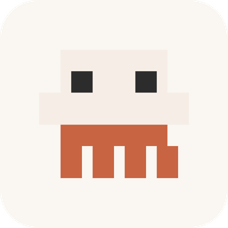

  

<h1 align="center">Quota Tray</h1>

  <strong>See your Claude Code limits before they stop you.</strong> 
  A tray app and floating widgets for macOS and Windows. Local only: no accounts, no servers, no telemetry.

  
  

---

## What is in this repo

Everything lives in [`quota-tray/`](quota-tray).

| What | Where | For |
| --- | --- | --- |
| **Quota Tray**: a tray app that shows Claude Code, Cursor and GitHub Copilot usage in one panel (Tauri 2, Rust, Svelte) | [`quota-tray/`](quota-tray) | macOS, Windows |
| **Chrome extension**: the same panel in the browser, plus Antigravity | [`quota-tray/extension`](quota-tray/extension) | Chrome |
| **macOS floating widget**: Claude usage only; faded icon at rest, full card on hover (Swift) | [`quota-tray/macos-widget`](quota-tray/macos-widget) | macOS 13+ |
| **Windows floating widget**: the same widget as one portable `ClaudeWidget.exe`; no installer, no admin rights (.NET 10, WPF) | [`quota-tray/windows-widget`](quota-tray/windows-widget) | Windows 10/11 |

The floating widgets show your 5-hour and 7-day Claude usage with reset times and a pace estimate. Drag them anywhere, double-click to open Claude Code, and optionally have them start your next 5-hour session automatically (`claude -p "<message>"`) when the current one ends. They can restart themselves if they crash and can start at login.

Setup, build and privacy details are in [`quota-tray/README.md`](quota-tray/README.md). Design notes are in [`docs/superpowers`](docs/superpowers).

## Credits and origin

This project began as a fork of **[Claude Tracker](https://github.com/BhargavDetroja/claude-tracker)** by **[Bhargav Detroja](https://claude-tracker.bhargavdetroja.com/)**, a Laravel and NativePHP menu bar app, released under the MIT licence. Thank you, Bhargav.

The original PHP app has been removed from this fork. It is still available upstream and in this repository's git history. What carries over from it:

- **The idea**, and the way it works: read the OAuth token that Claude Code already stored, send it only to Anthropic, and call the usage endpoint.
- **The pixel creature** that fills from its feet as you spend your limit. The grid comes from the original's `PixelMascot`, and the icons and widgets here reuse it.
- **The honesty rule**: when a check fails, keep the last reading and mark it stale instead of showing a confident zero.

Everything else (the Tauri tray app, the Chrome extension, the multi-provider support, and the macOS and Windows widgets) was written for this fork. Some of it was written with AI assistance (Claude Code and Cursor).

If you use or build on this repository, please keep the licence notices (below) and consider linking back to the original project.

## Licence

[MIT](LICENSE). Copyright (c) 2026 Bhargav Detroja, and (c) 2026 Lovin Maxwell and contributors. The original copyright notice must stay with any copy or substantial portion of the code.

Quota Tray reads local credentials and calls unofficial vendor endpoints that may change without notice; use it at your own risk. See [`quota-tray/README.md`](quota-tray/README.md) for exactly what is read and where it is sent.
