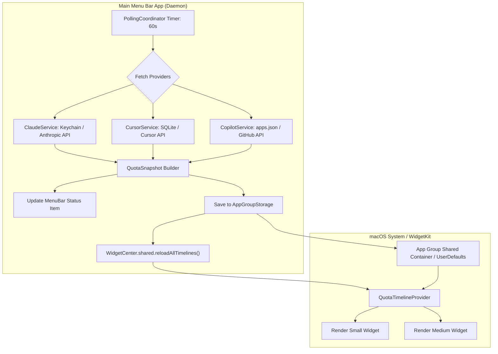

# Native macOS Menu Bar App & WidgetKit Extension (PRD & Design Spec)

**Document ID:** `2026-09-28-native-mac-tray-and-widget-design`  
**Date:** 2026-09-28  
**Status:** Approved for Implementation  
**Platform:** macOS 14.0+ (Sonoma) & macOS 15.0+ (Sequoia)  
**Stack:** Swift 6, SwiftUI, AppKit, WidgetKit  

---

## 1. Product Overview & Goals

### 1.1 Summary
A 100% native macOS application and companion **WidgetKit** extension (`QuotaTrayMac`) that delivers instant, glanceable visibility into AI coding quotas for **Claude Code**, **Cursor**, and **GitHub Copilot**. 

It replaces heavyweight webview runtimes with an ultra-lightweight, battery-efficient native Swift architecture, providing:
1. A **Menu Bar Tray** with a custom 12-pill segmented radial ring and pixel mascot.
2. An interactive **Menu Bar Popover HUD** detailing session windows, allowances, and reset timers.
3. Native macOS **Desktop and Notification Center Widgets** (`SystemSmall` and `SystemMedium`) powered by Apple's `WidgetKit`.

### 1.2 Core Goals
- **True macOS Native Experience**: Pure Swift 6, SwiftUI, and WidgetKit with zero Node.js/Rust/Webview runtime overhead. Memory footprint under 20 MB RAM and launch latency under 50 ms.
- **Glanceable Multi-Provider Quotas**: Monitor Claude Code (5h session & weekly allowance), Cursor (fast requests & cycle renew), and GitHub Copilot (plan & limits) in one synchronized view.
- **WidgetKit Integration**: Native macOS widgets that can be pinned directly to the desktop or accessed in Notification Center.
- **Local-Only Privacy**: Direct local credential reads from macOS Keychain and local config databases. Requests go exclusively and directly to vendor HTTPS endpoints. Zero telemetry, zero external servers.
- **Honest Degraded States**: Retain and display cached readings marked with relative staleness timestamps instead of false zeros during network drops or API rate limits.

### 1.3 Non-Goals
- Web/Cross-platform UI (this target is macOS only).
- Creating/managing custom backend accounts or server-side sync.
- Cloud code execution or editing (read-only quota tracking).

---

## 2. Technical Architecture & Data Flow

### 2.1 Project Structure (`mac/`)
The native project is organized as a multi-target Xcode project managed via Xcode or declarative `project.yml` (`xcodegen`):

```
mac/
├── project.yml                          // Declarative project spec for xcodegen
├── QuotaTray.xcodeproj                  // Generated or tracked Xcode project
├── Shared/                              // Shared code between Main App & Widget
│   ├── Models/
│   │   ├── ProviderType.swift           // enum: claude, cursor, copilot
│   │   ├── QuotaSnapshot.swift          // Master Codable snapshot model
│   │   ├── ClaudeUsage.swift            // 5h session + 7-day allowance metrics
│   │   ├── CursorUsage.swift            // Fast requests, hard limit, reset date
│   │   └── CopilotUsage.swift           // Plan type, assigned quota, status
│   ├── Storage/
│   │   ├── AppGroupStorage.swift        // UserDefaults(suiteName:) + local fallback
│   │   └── KeychainReader.swift         // Security.framework wrapper for Claude credentials
│   ├── Formatters/
│   │   ├── QuotaFormatters.swift        // Percentages, currency, token counts
│   │   └── RelativeTimeFormatter.swift  // "Resets in 2h 15m", "Checked 42s ago"
│   └── Graphics/
│       ├── MascotBitmap.swift           // Pure vector/bitmap pixel mascot drawing
│       └── PillRingRenderer.swift       // CoreGraphics/SwiftUI 12-pill radial generator
├── App/                                 // Main Menu Bar App Target (LSUIElement = YES)
│   ├── Info.plist
│   ├── Sources/
│   │   ├── QuotaTrayApp.swift           // App lifecycle & NSApplicationDelegateAdaptor
│   │   ├── MenuBar/
│   │   │   ├── StatusItemManager.swift  // NSStatusItem controller & click handlers
│   │   │   └── MenuBarLabelView.swift   // SwiftUI dynamic tray icon + text label
│   │   ├── Popover/
│   │   │   ├── PopoverViewController.swift // NSPopover host with vibrancy
│   │   │   ├── PopoverHUDView.swift     // Main container view
│   │   │   ├── ProviderCardView.swift   // Individual provider quota cards
│   │   │   ├── SegmentedProgressBar.swift // 12-segment HUD bar
│   │   │   └── PopoverHeaderView.swift  // Title, refresh trigger, settings button
│   │   ├── Services/
│   │   │   ├── PollingCoordinator.swift // 60s background timer & network reachability
│   │   │   ├── ClaudeService.swift      // Anthropic /oauth/usage API client
│   │   │   ├── CursorService.swift      // SQLite state.vscdb reader + API client
│   │   │   └── CopilotService.swift     // ~/.config/github-copilot reader + API client
│   │   └── Settings/
│   │       └── SettingsView.swift       // Preferences (launch at login, refresh rate)
│   └── Resources/
│       └── Assets.xcassets
└── Widget/                              // WidgetKit Extension Target
    ├── Info.plist
    ├── Sources/
    │   ├── QuotaWidgetBundle.swift      // @main WidgetBundle definition
    │   ├── QuotaWidget.swift            // Widget configuration & supported families
    │   ├── QuotaTimelineProvider.swift  // TimelineProvider reading AppGroupStorage
    │   ├── QuotaEntry.swift             // TimelineEntry wrapping QuotaSnapshot
    │   └── Views/
    │       ├── SmallWidgetView.swift    // SystemSmall single-provider circular gauge
    │       └── MediumWidgetView.swift   // SystemMedium 3-column multi-provider HUD
    └── Resources/
        └── Assets.xcassets
```

### 2.2 Data Flow & App Group Sharing



#### Shared Storage Rules:
- **Identifier**: `group.com.lovinmaxwell.QuotaTray` (or configured via bundle ID).
- **Fallback**: When running in unsigned local development mode, falls back to `~/Library/Application Support/QuotaTray/snapshot.json`.
- **Payload**: Full normalized `QuotaSnapshot` serialized as JSON with timestamp, provider states, and error metadata.
- **Zero-Network in Widget**: The WidgetKit extension **never** performs network I/O or Keychain calls directly. It loads the cached snapshot instantly from `AppGroupStorage`. This guarantees instant widget rendering and prevents memory watchdog terminations.

---

## 3. Provider Authentication & Protocol Details

### 3.1 Claude Code
- **Local Credential**: 
  1. Keychain query: `kSecClassGenericPassword` with service `"Claude Code-credentials"`.
  2. Fallback: Parse `~/.claude/.credentials.json` if present.
- **Network Call**:
  ```http
  GET https://api.anthropic.com/api/oauth/usage HTTP/1.1
  Host: api.anthropic.com
  Authorization: Bearer <oauth_token>
  anthropic-beta: oauth-2025-04-20
  ```
- **Response Parsing**:
  - `five_hour_utilization`: Session usage (0.0 to 1.0) and `five_hour_resets_at` (ISO-8601).
  - `seven_day_utilization`: Weekly allowance (0.0 to 1.0) and `seven_day_resets_at` (ISO-8601).

### 3.2 Cursor
- **Local Credential**:
  - SQLite database located at: `~/Library/Application Support/Cursor/User/globalStorage/state.vscdb`.
  - Query: `SELECT value FROM ItemTable WHERE key = 'cursorAuth/accessToken'`.
- **Network Call**:
  ```http
  POST https://api2.cursor.sh/aiserver.v1.DashboardService/GetCurrentPeriodUsage HTTP/1.1
  Host: api2.cursor.sh
  Authorization: Bearer <access_token>
  Content-Type: application/json
  
  {}
  ```
- **Response Parsing**:
  - Fast request usage (`numRequestsTotal`), allowance threshold, and monthly renewal timestamp.

### 3.3 GitHub Copilot
- **Local Credential**:
  - File: `~/.config/github-copilot/apps.json` (or `~/.config/github-copilot/hosts.json`).
  - Extract token matching prefix `gho_` or `ghu_`.
- **Network Call**:
  ```http
  GET https://api.github.com/copilot_internal/user HTTP/1.1
  Host: api.github.com
  Authorization: Bearer <oauth_token>
  Accept: application/json
  ```
- **Response Parsing**:
  - Assigned plan, quota metrics, and subscription renew date.

---

## 4. UI/UX Design System & Mobbin References

### 4.1 Design Inspiration & Mobbin Design Patterns
The design adheres to the highest tier of macOS utility design patterns cataloged on **Mobbin** (specifically referencing **Raycast**, **CleanShot X**, **Linear Widgets**, and **Flighty macOS widgets**):

| Design Element | Mobbin Reference Pattern | Native Implementation |
|---|---|---|
| **Vibrancy & Material** | Raycast & Linear macOS Popovers | System `.ultraThinMaterial` background with a subtle 0.5pt border (`Color.white.opacity(0.12)`) in dark mode and light mode drop shadow. |
| **Card Hierarchy** | Linear Issue cards / macOS Settings | Floating rounded cards (`CornerRadius = 10`) with `.secondary` background fill, 12pt inner padding, and crisp label hierarchy. |
| **Glanceable Progress** | Activity Rings / Flighty Status Rings | 12-pill segmented radial ring in the tray and 12-segment horizontal pill bars in the HUD matching the physical aesthetic. |
| **Typography** | Apple Human Interface Guidelines | Monospaced digits (`.font(.system(.body, design: .monospaced))`) for countdown timers and percentages to prevent character jitter during countdowns. |
| **Micro-Interactions** | CleanShot X Quick Menu | Hover-activated refresh icon spin, smooth pill segment color transitions (`.animation(.smooth(duration: 0.35))`), and responsive cursor pointer cues. |

### 4.2 Menu Bar Tray Icon
- **Canvas**: Pure 100% transparent RGBA (`32x32` / `@2x 44x44`).
- **Center**: Mascot pixel icon with body fill progressing from 0% (feet) to 100% (head).
- **Perimeter Ring**: 12 curved capsule pill segments arranged radially:
  - Pills $0$ to $8$: Filled with provider accent color (Claude Terracotta `#C96442`, Cursor Sage `#5A7A6A`, Copilot Slate `#3D5A80`).
  - Pills $9$ to $11$: Light up in coral/red alert (`#D94B34`) when quota $\ge 75\%$.
- **Tooltip**: Hover displays `Claude: 42% (resets in 1h 45m) · Cursor: 60/500`.

### 4.3 Menu Bar Popover HUD Layout
```
+-----------------------------------------------------------+
|  QUOTA TRAY                              (Refresh) (Gear) |
|  Updated 32s ago                                          |
+-----------------------------------------------------------+
|  [Claude Icon]  CLAUDE CODE                       42%     |
|  Session (5h): [||||||......] 42%    Resets in 2h 18m     |
|  Weekly:       [||||........] 35%    Resets in 4d 12h     |
+-----------------------------------------------------------+
|  [Cursor Icon]  CURSOR                            68%     |
|  Fast Requests: [||||||||....] 340/500   Renews Oct 12    |
+-----------------------------------------------------------+
|  [Copilot Icon] GITHUB COPILOT                    Active  |
|  Copilot Pro - Unlimited Completions                      |
+-----------------------------------------------------------+
|  [✓] Launch at Login                    [Quit Quota Tray] |
+-----------------------------------------------------------+
```

### 4.4 WidgetKit Extension Specifications

#### SystemSmall Widget (Single Provider / Focus Mode)
- **Dimensions**: $170 \times 170$ pt.
- **Content**:
  - Top: Provider title + small logo pill.
  - Center: Large 12-pill radial ring with the pixel mascot inside, indicating 5-hour session progress.
  - Bottom: Primary percentage (`42%`) and reset countdown (`2h 18m`).

#### SystemMedium Widget (Multi-Provider 3-Column HUD)
- **Dimensions**: $360 \times 170$ pt.
- **Content**: 3 equal-width columns partitioned by subtle vertical dividers:
  - **Column 1 (Claude)**: Header, 5h session progress bar + percentage, 7-day allowance bar, reset countdown.
  - **Column 2 (Cursor)**: Header, fast requests used / total, monthly renewal date, warning indicator if throttled.
  - **Column 3 (Copilot)**: Header, subscription plan badge, active status pill, and next renewal date.
- **Empty / Stale Mode**: Amber status dot with "Stale" label if background app has not refreshed within 10 minutes.

---

## 5. Resilience & Error Handling

1. **No Phantom Zeros**: If an API call fails with HTTP 5xx, timeout, or rate limiting (HTTP 429), the provider state preserves `lastSuccessfulUsage` and sets `status = .stale(lastUpdated: Date)`.
2. **Keychain Access Prompts**: Provide a clean explanation panel in the app upon initial launch explaining why macOS requests Keychain permission for `"Claude Code-credentials"`.
3. **Offline Mode**: When internet connectivity drops (detected via `NWPathMonitor`), the UI gracefully displays an offline banner without popping error alerts.
4. **Widget Reload Throttling**: The main app throttles `WidgetCenter.shared.reloadAllTimelines()` to fire at most once every 60 seconds to comply with system widget reload budgets.

---

## 6. Development Instructions & Setup

### 6.1 Prerequisites
- Apple Silicon or Intel Mac running macOS 14.0 or higher.
- Xcode 15.3+ or Xcode 16+ with Command Line Tools installed (`xcode-select --install`).
- Optional: `xcodegen` (`brew install xcodegen`) for generating `.xcodeproj` from `project.yml`.

### 6.2 Initial Workspace Setup
1. The native code resides in the `mac/` directory of the repository.
2. Generate the Xcode project:
   ```bash
   cd mac
   xcodegen generate
   ```
3. Open `QuotaTray.xcodeproj` in Xcode or build via terminal:
   ```bash
   xcodebuild -scheme QuotaTray -configuration Debug build
   ```

### 6.3 Development & Debugging Workflow
1. **Running the App Target**:
   - Run scheme `QuotaTray`.
   - The app runs as an agent in the menu bar (`LSUIElement = true`).
2. **Testing the Widget**:
   - Select the `QuotaTrayWidget` scheme in Xcode.
   - Run against the macOS Widget Simulator or use SwiftUI Canvas Previews in `MediumWidgetView.swift` and `SmallWidgetView.swift`.
3. **Preview Mock Data**:
   - `Shared/Models/QuotaSnapshot.swift` includes static `.mock` and `.empty` snapshots for zero-latency SwiftUI preview rendering.

---

## 7. Verification & Acceptance Criteria

- [ ] `xcodebuild -scheme QuotaTray build` and `xcodebuild -scheme QuotaTrayWidget build` complete with 0 errors and 0 warnings.
- [ ] Launching `QuotaTray.app` displays the menu bar tray item with the 12-pill segmented radial ring and mascot.
- [ ] Clicking the menu bar item opens the translucent popover HUD displaying active quotas.
- [ ] Credentials for Claude, Cursor, and Copilot are resolved from Keychain/disk without asking for manual token input.
- [ ] Adding the `QuotaTray` widget in macOS Desktop / Notification Center displays the Small or Medium widget rendered with live snapshot data.
- [ ] Network interruption retains the last reading marked as stale with an amber warning badge.
- [ ] Total application memory usage remains below 25 MB.
